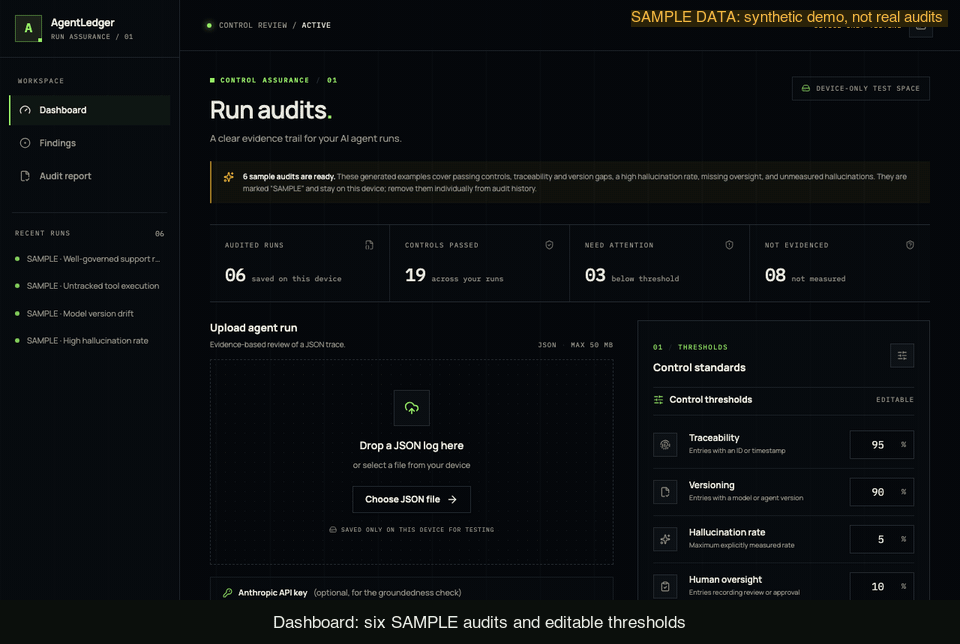
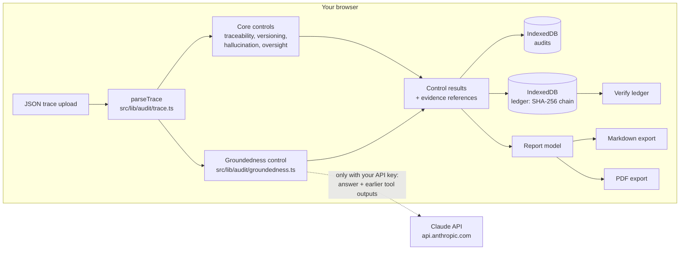

# AgentLedger

**Audit AI-agent run logs in your browser. Every result links to the exact log entry behind it, and every audit is sealed in a tamper-evident hash chain.**

**Live demo:** https://ranjini26.github.io/agent-evidence-ledger/



_The demo shows synthetic **SAMPLE** data only. None of it describes a real agent, customer or system._

## Why AgentLedger

1. **Evidence-linked, never invented.** Each control result cites the trace steps and JSON fields it was computed from. Missing data is reported as **not evidenced**, never as a pass and never as zero.
2. **Groundedness checked against the agent's own tool outputs.** Claude extracts each answer's factual claims and checks them against tool outputs that appear _earlier_ in the same trace. It uses your own API key, which is held in memory only. Every result records the method, the model and the prompt version, and an eval harness measures agreement with your hand labels.
3. **Tamper-evident and local.** Every audit is appended to a SHA-256 hash chain in your browser (WebCrypto + IndexedDB). **Verify ledger** recomputes the chain and names the record that broke it. Reports export to Markdown and PDF on the device.

## Quick start

**Try the demo.** Open the [live demo](https://ranjini26.github.io/agent-evidence-ledger/). Six SAMPLE audits are created in your browser. Upload any trace from [`evals/groundedness/traces/`](evals/groundedness/traces/) (also synthetic) or one of your own.

**Run it locally** ([Bun](https://bun.sh) 1.3+):

```sh
bun install --frozen-lockfile
bun run dev           # http://localhost:8080
bun run test          # unit tests
bun run build:pages   # static build for GitHub Pages → dist/client
```

**Trace format.** The minimum is a list of steps. The full schema and the accepted alternative field names are in [`docs/trace-schema.md`](docs/trace-schema.md). The values below only illustrate the format.

```json
{
  "schema": "agentledger.trace.v1",
  "steps": [
    {
      "step_id": "t1",
      "type": "tool_output",
      "tool_name": "orders.lookup",
      "content": { "status": "shipped" }
    },
    {
      "step_id": "a1",
      "type": "model_answer",
      "model_version": "agent-v3",
      "human_review": true,
      "is_hallucination": false,
      "content": "Your order has shipped."
    }
  ]
}
```

## Controls

| Control         | What is measured                                                    | Default threshold | NIST AI RMF 1.0\* |
| --------------- | ------------------------------------------------------------------- | ----------------- | ----------------- |
| Traceability    | % of steps with a usable ID or timestamp                            | ≥ 95%             | MEASURE 2.8       |
| Versioning      | % of steps recording a model/agent version                          | ≥ 90%             | MANAGE 4.1        |
| Hallucination   | Rate from labels on every step, or a rate in the log                | ≤ 5%              | MEASURE 2.5       |
| Human oversight | % of steps recording human review or approval                       | ≥ 10%             | MAP 3.5           |
| Groundedness    | % of answer claims supported by earlier tool outputs (Claude judge) | ≥ 90%             | MEASURE 2.5       |

\*The mappings are AgentLedger's interpretation. Check them against NIST AI 100-1 before relying on them. The default thresholds are editable starting points, not benchmarks.

## Architecture



- `src/lib/audit/` is pure TypeScript with no UI imports (a test enforces this). It contains the trace schema, the declarative control rules, evaluation, groundedness, agreement metrics, the ledger and the SAMPLE fixtures.
- `src/lib/judge/` is the Claude judge (`claude-opus-5-5`, prompt `groundedness-v1`).
- `src/lib/report/` renders one report model to Markdown and to PDF, using a dependency-free PDF writer.
- `src/components/agent-ledger/` and `src/routes/` hold the React UI (TanStack Start/Router, Tailwind, shadcn/ui).

See [`docs/ledger.md`](docs/ledger.md) for the record format and the verification rules.

## Eval results

**No results yet.** The groundedness check has not been run against hand labels, so there are no precision, recall or agreement figures to report. None are shown here until they exist.

What is in place:

- [`evals/groundedness/`](evals/groundedness/) holds 34 synthetic SAMPLE traces with 37 model answers. Each answer has an `authored_intent` (what its author built it to be: 18 grounded, 19 ungrounded) and an empty `human_label` column for a person to fill in.
- `ANTHROPIC_API_KEY=… bun run eval:groundedness` runs the check and writes a report with precision, recall, F1, agreement and Cohen's kappa against the hand labels. The positive class is _ungrounded_. Each run makes one Claude call per answer, billed to that key.
- Agreement with `authored_intent` is also reported, clearly marked as a dataset sanity check, not accuracy.

With 37 synthetic answers, any future figure is a rough indication, not a benchmark.

## Limitations: what AgentLedger does not do

- **It is not a certification.** It is not a compliance certification, security assessment, legal opinion or independent verification. It summarises the evidence in the log you supply.
- **It does not check that a log is authentic or complete.** It audits the JSON it is given. A fabricated or edited log produces a confident-looking audit of fabricated data.
- **It does not detect hallucinations by itself.** The hallucination control only reads labels or rates already in the log. Groundedness only checks answers against _earlier tool outputs in the same trace_, not against the world, and an LLM judge can be wrong. Its agreement with humans has not been measured yet (see [Eval results](#eval-results)).
- **The ledger is not a signature or an external anchor.** It detects edits, insertions, removals and reordering of earlier records. It cannot detect removal of the newest records or a rewrite of the whole chain. It lives in one browser: there is no sync, and clearing site data deletes it. Audits saved before the ledger existed are listed as "not in the ledger".
- **The public demo has no accounts.** Sign-in and cloud storage exist in the code but are switched off (`TEMPORARY_DEVICE_ONLY_TEST_MODE`). Everything stays in the browser that opened the page.
- **It is not fully offline.** Audits, the ledger and exports make no network calls. However, the page loads web fonts from Google Fonts, and the groundedness check sends each answer and its earlier tool outputs to Anthropic's API when you enter a key.
- **PDF export uses standard fonts.** Characters outside the WinAnsi set are replaced, for example `≥` becomes `>=`.

## Sample data

All bundled data is synthetic and labelled **SAMPLE**:

- the six dashboard audits (`src/lib/audit/fixtures.ts`);
- the 37 eval answers (`evals/groundedness/`);
- the demo GIF.

None of it describes a real agent, customer, company or system, and none of it is a measurement.

## Roadmap

Planned work is tracked as [GitHub issues labelled `roadmap`](https://github.com/ranjini26/agent-evidence-ledger/issues?q=is%3Aissue+label%3Aroadmap).

## Contributing and license

See [CONTRIBUTING.md](CONTRIBUTING.md). Released under the [MIT License](LICENSE).

AgentLedger was started in [Lovable](https://lovable.dev). Commits to `main` sync back to the Lovable project. See [AGENTS.md](AGENTS.md) for what Lovable manages.
